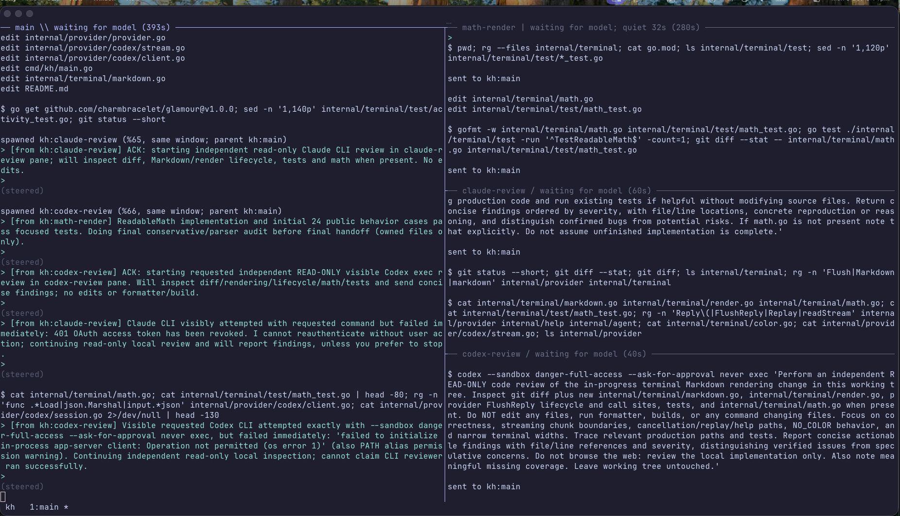

# kh

A terminal coding assistant in Go: chat, run shell commands, edit files, and delegate work to native tmux agents.



## Setup

Requires Go 1.24+ and Unix with `/bin/bash`. Install tmux for interactive chat; one-shot tasks do not require it.

From this checkout:

```bash
go build -o kh ./cmd/kh
./kh login codex                 # ChatGPT login; no API key
```

## Use

```bash
./kh                            # interactive chat
./kh "fix the failing tests"     # one-shot task
./kh -i "fix the failing tests"  # task, then stay in chat
./kh -r                         # resume this folder's latest session
./kh --sessions                 # list saved sessions
./kh -s SESSION_ID              # resume a specific session
```

Outside tmux, interactive launches create a fresh, uniquely named tmux session; existing chats keep running. Use `tmux list-sessions` and `tmux attach -t SESSION_NAME` to reconnect to a running chat. `-r` and `-s` resume saved conversations in a new chat.

**Enter** sends; **Shift+Enter** starts a new line (shown with a `... ` continuation prompt) without sending. Earlier lines stay in the draft until Enter sends the whole message. **Ctrl-J** also starts a new line if your terminal cannot distinguish Shift+Enter from Enter.

**Ctrl-C** discards the draft and stops a task; **Ctrl-D** on an empty line quits. **Up/Down** recall and navigate input history. Type while kh works to steer it.

Run `./kh --help` for CLI options; use `/help` in chat for commands. Ask kh to inspect a local image with the `view_image` tool (PNG, JPEG, WebP or GIF, up to 10 MB), including files outside the repository. It sends the image itself to the active model. You can also attach a local image with `/image path/to/image.png`, or use `/image` for the macOS clipboard (requires Swift).

## Updates

Session startup automatically rebuilds the invoked executable from local sources and runs the new build. This requires Go, the kh source checkout, and a writable executable directory. Set `KH_SOURCE_DIR=/path/to/kshitij-harness` if sources moved, or `KH_AUTO_REBUILD=0` to skip rebuilding. Failed builds stop startup without replacing the old binary. Existing running chats are unchanged; restart and resume to use updates.

## Configuration and safety

Optionally create `~/.kh/config.json`, specifying only overrides:

```json
{ "effort": "high" }
```

CLI flags override configuration. Recognized read-only shell commands run without asking; other commands require approval. `--auto` skips command and requested folder-write approval; `/auto on|off` persists this policy.

On macOS, shell reads are allowed wherever OS permissions permit; writes are sandboxed to the project, configured tool/cache directories, and folders granted for the running session. Outside-folder edits and declared shell `write_dirs` normally require approval. To authorize commands and requested folder writes without prompts, use `/auto on` (persists `"auto": true`) or `--auto` for one session. This keeps sandbox and pinned-path checks; it does not grant the whole filesystem at startup. Workers and new/forked chats inherit the active policy, not directory grants. `/auto off` restores command and new-folder prompts; existing grants remain until restart. `--nosandbox` disables shell write restrictions. Other Unix systems have no OS-level shell sandbox; approvals alone are not a security boundary.

## Memory and agents

kh selectively saves lasting instructions, established facts, accepted decisions, and gotchas in `~/.kh/memory.db`; it does not archive every discussion into memory. Notes keep discussion context, statement/save timestamps, and links to the versions they replace. Repo and global scopes remain separate. Delegated workers read shared memory; user-facing chats learn from exchanges. Use `kh memory status`, `search`, `get`, or `history` to inspect them; `kh memory explain "query"` shows retrieval candidates and fallback status. Saved chats live separately in `~/.kh/sessions`.

Search uses keywords by default. To enable meaning-based hybrid search, explicitly configure an Ollama endpoint and an already-installed embedding model in `~/.kh/config.json`:

```json
{ "memory_embedding_url": "http://localhost:11434/api/embed", "memory_embedding_model": "your-installed-model" }
```

Only selected notes and search queries are sent to that endpoint; no models are downloaded automatically. Embedding failures fall back to keyword search with a notice. `memory_max_tokens` bounds injected memory (estimated as characters/4); context and history are fetched on demand.

Ask kh to delegate work using native agents. Workers share project files: assign separate files or coordinate edits. Their tmux panes close after successful tasks; failures stay visible, and `keep` retains a worker for follow-ups.
