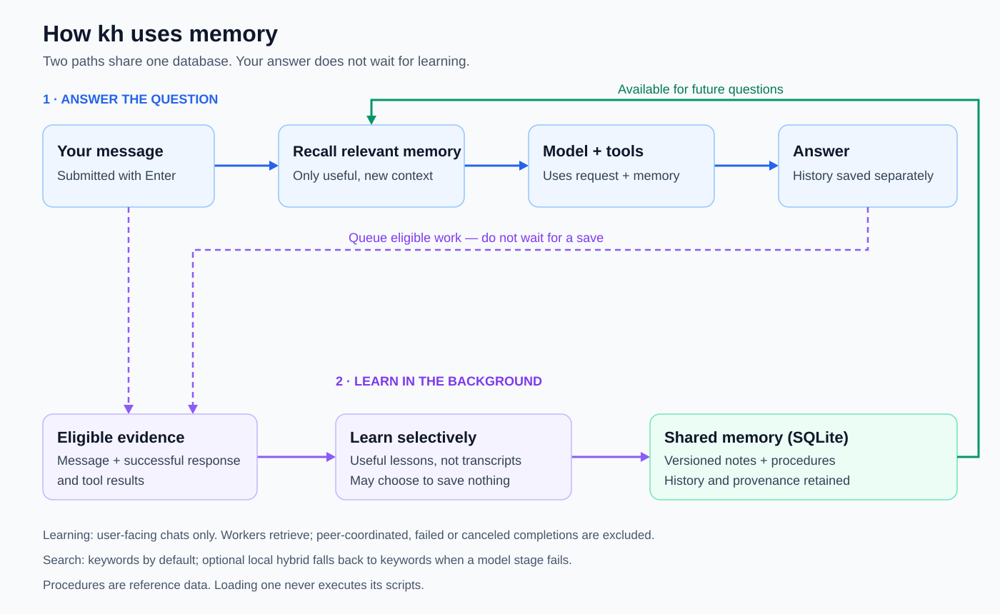

# Architecture

Understand how kh connects model orchestration, tools, conversation state, and learning. Operating instructions and history live on each feature's owning page.

## Source map

Use this map to find the owning package; linked feature pages explain behavior and history.

| Package / source | Responsibility | Feature guide |
|---|---|---|
| [`cmd/kh`](../cmd/kh/) | CLI entry points, chat lifecycle, and application wiring | [Chat modes](chat-modes.md), [native agents](native-agents.md) |
| [`internal/agent`](../internal/agent/) | Model/tool turn orchestration | [Execution loop](execution.md) |
| [`internal/backend`](../internal/backend/) | Provider construction and selection | [Provider state](provider-state.md) |
| [`internal/config`](../internal/config/) | Defaults and persisted configuration | [Model settings](model-settings.md) |
| [`internal/help`](../internal/help/) | Standalone help requests | [Help](help.md) |
| [`internal/hybrid`](../internal/hybrid/) | Managed local retrieval services | [Hybrid runtime](hybrid-runtime.md) |
| [`internal/image`](../internal/image/) | Image attachment reading and clipboard snapshots | [Images](images.md) |
| [`internal/learn`](../internal/learn/) | Background extraction and learning safeguards | [Learning queue](learning-queue.md), [origin protections](learning-origin.md) |
| [`internal/memory`](../internal/memory/) | Versioned storage, retrieval, and reference bundles | [Knowledge store](knowledge-store.md), [hybrid retrieval](hybrid-retrieval.md), [portability](procedure-portability.md) |
| [`internal/provider`](../internal/provider/) | Provider contract and protocol adapters | [Provider state](provider-state.md), [connection recovery](connection-recovery.md) |
| [`internal/repomap`](../internal/repomap/) | Repository context generation | [Repository map](repository-map.md) |
| [`internal/session`](../internal/session/) | Saved session files and state | [Saved sessions](saved-sessions.md) |
| [`internal/terminal`](../internal/terminal/) | Input, rendering, and terminal feedback | [Input](input.md), [Markdown](markdown.md), [feedback](terminal-feedback.md) |
| [`internal/tools`](../internal/tools/) | Tool implementations, approvals, and filesystem safety | [Shell](shell.md), [editing](editing.md), [write approvals](write-approvals.md) |

## Application and turn loop

The [CLI](../cmd/kh/main.go) selects configuration, opens stores, and assembles tools. The [chat lifecycle](../cmd/kh/chat.go) manages retrieval, learning, persistence, and controls. The [runner](../internal/agent/loop.go) needs only the provider's `Step` method:

[Memory overview SVG](../diagrams/memory-architecture.svg): recall supplies the answer path; selective learning saves useful knowledge in the background. See [knowledge storage](knowledge-store.md) for database details.

The [execution loop](execution.md) runs tool batches concurrently and returns results in call order. Shared files require explicit dependency coordination. See [learning hooks](learning-hooks.md) for message timing and [native agents](native-agents.md) for delegation.

## Provider-owned history

The [provider contract](../internal/provider/provider.go) owns protocol state, save/load, replay, settings, and usage metrics. The [backend selector](../internal/backend/backend.go) currently implements only Codex; an interface is not multiple working providers.

[Provider state](provider-state.md) defines failed-step cleanup. [Saved sessions](saved-sessions.md) persist conversations; [steering](steering.md) controls active turns; [compaction](compaction.md) summarizes working context.

## Presentation and context

[Markdown rendering](markdown.md) owns whole-reply presentation; [terminal feedback](terminal-feedback.md) and [turn metrics](turn-metrics.md) expose runtime signals. [Repository maps](repository-map.md) provide optional initial project context. [Keyword recall](keyword-recall.md) and optional [hybrid retrieval](hybrid-retrieval.md) select bounded memory context; details load on demand.

Conversation history, [durable knowledge](knowledge-store.md), and project files are separate. Retrieved notes and [procedure assets](procedure-loading.md) are reference data, not execution authority.

## Design boundaries

- **Runner:** model/tool orchestration, independent of a concrete backend.
- **Provider:** protocol, resumable conversation state, and model capabilities.
- **Application:** lifecycle, policy, memory hooks, and delegation wiring.
- **Tools:** process/filesystem access, [approval policy](write-approvals.md), and [sandbox enforcement](shell-sandbox.md).
- **Memory store:** versioned knowledge and inert procedure payloads, not execution authority.

[Feature index](README.md) · [Development](development.md)
