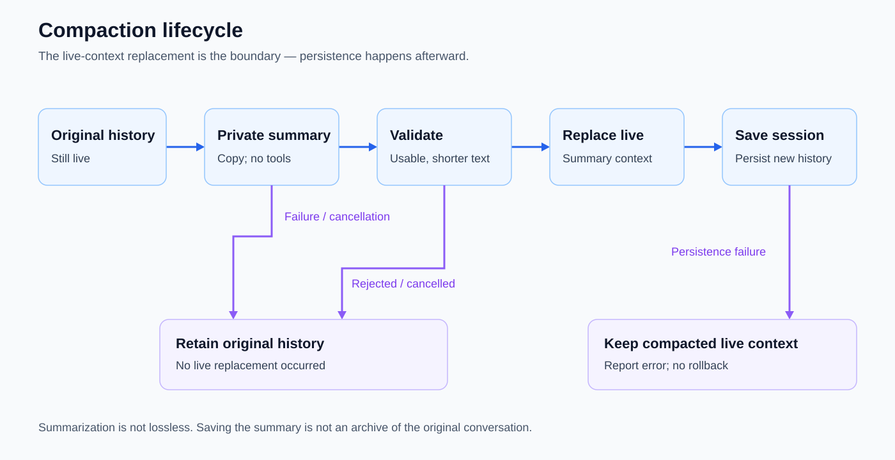

# Context compaction

Extend a long conversation by replacing its working context with a summary.

Introduced **2026-10-04** · commit `c8de1bf`.

## Current behavior

- `/compact` requests a tool-less summary and saves the resulting session.
- Cancellation or summary failure preserves the original history. If the later save fails, context is already compacted and the error reports that distinction. The summarizing request cannot execute local tools or use web search.
- Summarization is not lossless; compaction is not an archival substitute for the original conversation or project evidence.

## Compaction lifecycle

Compaction summarizes a private copy with `tool_choice: "none"`, validates that the text is usable and reduces context, then replaces live history before saving. Cancellation or failure before replacement retains the original. Persistence failure after replacement reports an error without rolling back compacted live context.

## Evolution

| Date | Change | Commit |
|---|---|---|
| 2026-10-04 | Added `/compact`, provider summarization, and cancellation/failure coverage. | `c8de1bf` |
| 2026-10-17 | Hardened tool-less compaction, feedback, and persistence handling. | `77639f2` |

## Inspect

[Compaction implementation](../internal/provider/codex/compact.go) · [Provider tests](../internal/provider/codex/test/compact_test.go) · [CLI tests](../cmd/kh/test/compact_test.go) · [Saved sessions](saved-sessions.md)

[Feature index](README.md)
