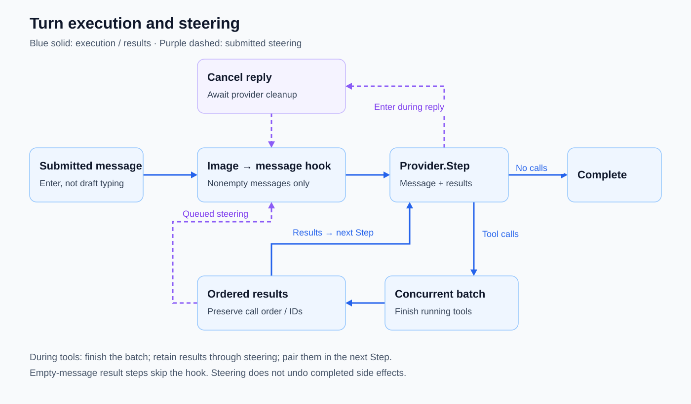

# Model/tool loop

Work through a request by alternating model replies and executable tool batches.

Introduced 2026-09-28 · commit `84d64c8`.

## Current behavior

Automatic: the runner asks the provider for the next step until no tool calls remain. Tool batches run concurrently and results return in call order. Tools share files, so dependent work requires coordination rather than relying on call ordering.

## Turn execution and steering

Solid blue arrows carry execution and results; dashed purple arrows carry submitted steering. Each nonempty message passes through pasted-image processing and `BeforeMessage` before `Provider.Step`. Image or hook failure aborts that message. Empty-message tool-result steps skip the hook.

A reply with tool calls starts a concurrent batch. The runner waits for every tool and preserves call order and IDs in the results supplied to the next step. No calls completes the turn. Queued steering takes the message path while retaining those results for the same next step; results are paired in provider history, not discarded.

Enter during a reply cancels it and waits for provider cleanup before processing the new message. Enter during tools waits for the batch instead. Neither path undoes completed side effects. See [steering controls](steering.md).

Verified against [`Runner.Run`, `step`, and `runAll`](../internal/agent/loop.go), public [steering tests](../internal/agent/test/loop_test.go), and [message-hook/order tests](../internal/agent/test/message_hook_test.go).

## Evolution

| Date | Change | Commit |
|---|---|---|
| 2026-09-28 | Introduced the model/tool loop with concurrent, ordered results. | `84d64c8` |
| 2026-10-01 | Separated backend protocol/state from runner orchestration. | `60e2bd1` |
| 2026-10-16 | Added a pre-message hook for actual initial, steering, and queued messages, preserving completed tool results on hook failure. | `46c225b` |

## Inspect

- [Runner](../internal/agent/loop.go) and [hook/order tests](../internal/agent/test/message_hook_test.go).
- [Architecture and turn loop](architecture.md#application-and-turn-loop).

[Feature index](README.md)
