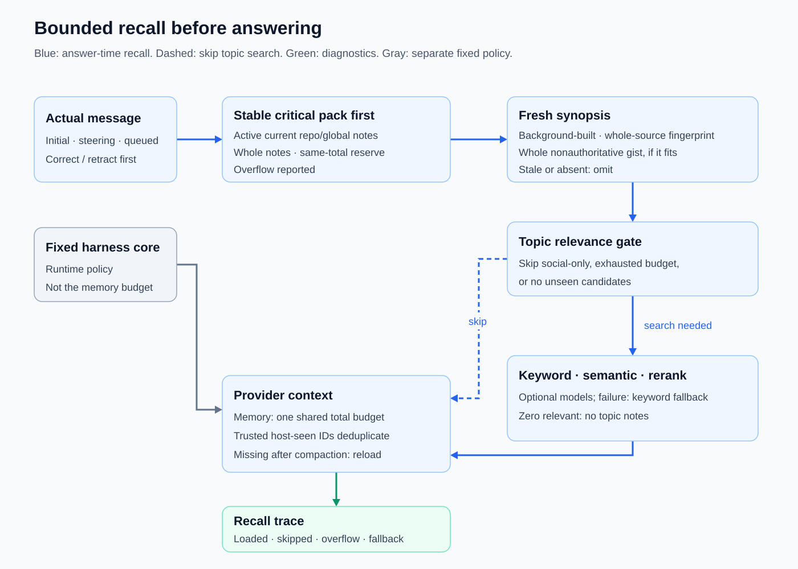

# Bounded keyword recall

Supply relevant stored knowledge before answering without requiring local model downloads.

Introduced **2026-09-29** · commit `14dd3e6`.

## Current behavior

Keyword-only retrieval is the default and requires no model downloads. After each actual user query arrives, including steering and queued messages, and before the provider answers, recall considers repo and global memory within `memory_max_tokens` (estimated as characters/4). Compact notes enter context; [history](memory-history.md) and [full procedures](procedure-loading.md) remain available on demand. See [learning hooks](learning-hooks.md) for timing relative to saving.

The default `memory_max_tokens` is **500**, reduced from 4,000 for [compact startup context](project-configuration.md#compact-context-and-tool-discovery). Explicit values in `~/.kh/config.json` are retained, including an existing 4,000 override or `0`; this change does not rewrite saved configuration. `summary_max_tokens` remains 2,500, but automatic injection still respects the total memory budget. These are character-based estimates, not provider-token measurements.

Common standalone greetings, check-ins, acknowledgments, and knowledge already present in chat avoid unnecessary topic retrieval. Corrections, required summary notes, and explicitly named references still load. Selection favors applicable notes with [provenance and replacement relationships](memory-history.md), not the volume of saved knowledge. Retrieval can miss or fail; relevance and completeness are not guaranteed. [Optional hybrid reranking](hybrid-retrieval.md) can reject weak matches rather than filling a quota. Use [diagnostics](retrieval-diagnostics.md) to inspect selection; current user requests override retrieved reference data. An intact current note can still miss lexical retrieval when the query uses different words or word forms; hybrid configuration alone does not prove that semantic retrieval or reranking succeeded on a particular turn.

## Retrieval flow

Corrections, named-reference hints, and summary-required notes are considered before the topic-search gate, not bypassed by it. They still respect seen tracking and the context budget. Only successfully injected notes become seen; budget-skipped notes remain eligible later.

The diagram follows [chat wiring](../cmd/kh/chat.go), [recall ordering](../internal/memory/recall.go), and [topic selection](../internal/memory/search.go). Search-stage failure and a successful search with no relevant topic notes are different outcomes.

## Evolution

| Date | Change | Commit |
|---|---|---|
| 2026-09-29 | Introduced keyword discovery with a small matching-detail and character cap before each answer. | `14dd3e6` |
| 2026-10-05 | Replaced discovery records with append-only notes, summary-aware recall, and conversation-based seen tracking. | `0a203a6` |
| 2026-10-16 | Added broader knowledge selection, a total context budget, and recall for actual steering/queued messages. | `46c225b` |
| 2026-10-23 | Added compact procedure hints and explicit reference matching. | `f802b27` |
| 2026-10-23 | Improved applicability selection, then skipped unnecessary topic retrieval. | `24e64b7`, `13e26fd` |
| 2026-11-02 | Reduced the default automatic memory budget to 500 estimated tokens without changing explicit configuration or recall/learning timing. | Current change |

## Inspect

- Source: [recall](../internal/memory/recall.go), [keyword selection](../internal/memory/search.go), [configuration defaults and overlay](../internal/config/config.go).
- Default/override coverage: [configuration tests](../internal/config/test/config_test.go).
- Tests: [selection](../internal/memory/test/selection_test.go), [recall efficiency](../internal/memory/test/recall_efficiency_test.go), [reference recall](../internal/memory/test/reference_recall_test.go).

[Feature index](README.md)
