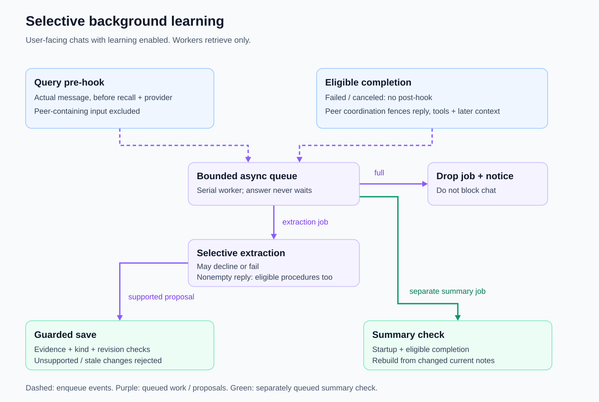

# Query and response learning hooks

Selectively retain lasting lessons without making extraction part of the foreground answer.

Introduced **2026-10-05** · commit `0a203a6`.

## Current behavior

Automatic learning selectively extracts lasting instructions, established facts, accepted decisions, and gotchas, rather than archiving every exchange. See [saving controls](memory-controls.md) and [origin eligibility](learning-origin.md).

After pasted-image handling succeeds, each actual nonempty initial, steering, or queued user message reaches `Runner.BeforeMessage` before `provider.Step`; empty tool-result steps do not trigger it. The chat callback queues `Learner.MessageAt` with the query, recent discussion, and event time, then retrieves applicable memory before the provider step. Answering does not wait for extraction to save.

After a successful, uncanceled eligible run, `Learner.FinishedAt` receives the current query, bounded recent context, observed tool results, reply, and event time. A nonempty reply queues durable-note extraction and eligible [procedure extraction](procedure-learning.md), followed by a summary check. Failed or canceled turns skip this completion hook. Extraction can decline or fail; [queue limits and summary rebuilding](learning-queue.md) also make saves non-guaranteed.

## Learning flow

Dashed arrows schedule work, not dependencies the answer waits for. The query hook runs before recall and provider execution; failed or canceled runs can already have queued query work but do not schedule completion work. Peer coordination permanently fences that run's completion evidence and recent context, even after clean steering; a separate clean query can still reach the pre-hook.

The flow follows [chat wiring](../cmd/kh/chat.go), [queue and extraction](../internal/learn/learn.go), and the [run-origin fence](../internal/learn/origin.go). Completion note/procedure extraction requires a nonempty reply; its summary check is separately queued and rebuilds only when current notes changed.

## Evolution

| Date | Change | Commit |
|---|---|---|
| 2026-10-05 | Added pre-query and post-response background hooks. | `0a203a6` |
| 2026-10-05 | Removed model-tool saving so automatic writes go through reported hooks. | `8ab0023` |
| 2026-10-16 | Moved query hooks into the runner for steering/queued messages; supplied context and timestamps, and excluded canceled completion hooks. | `46c225b` |
| 2026-10-23 | Fenced peer-coordinated completion evidence and added procedure extraction. | `23e7a86` |

## Inspect

- Source: [chat wiring](../cmd/kh/chat.go), [runner](../internal/agent/loop.go), [learner](../internal/learn/learn.go).
- Tests: [message hooks](../internal/agent/test/message_hook_test.go), [selective learning](../internal/learn/test/selective_test.go).

[Feature index](README.md)
