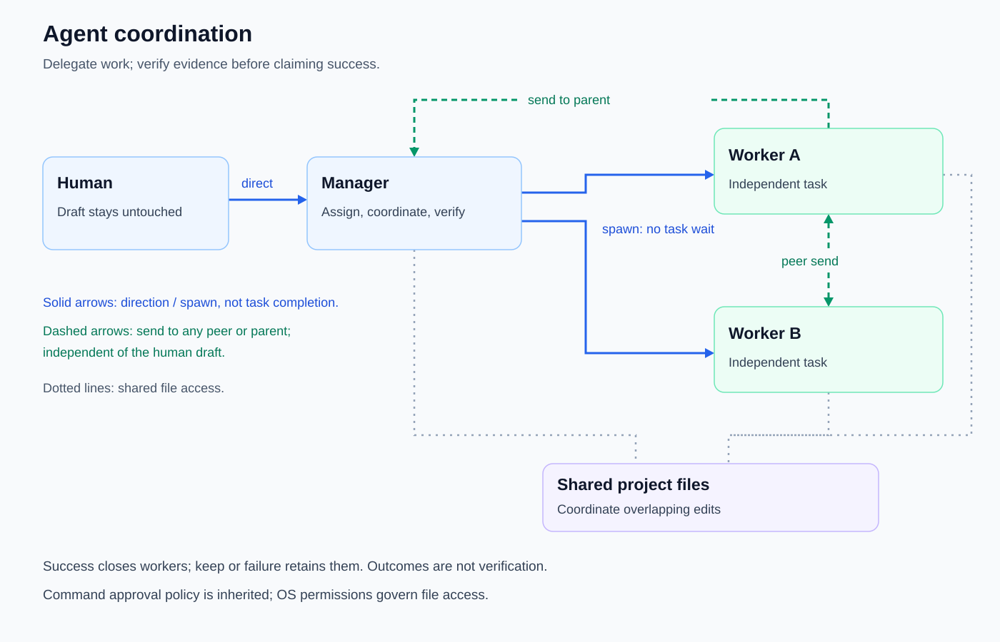

# Native agent ecosystem

Delegate independent tasks recursively, with one shared directory and capacity budget.

Introduced **2026-09-29** · commit `277c243` (tmux sub-agent commands).

## Current behavior

- The root session is a fixed manager. Descendants start as workers and can change their own role with `set_role` (`role: manager` or `worker`). Only managers can `spawn`; promotion enables recursive delegation without creating another capacity allowance.
- `spawn` takes `name` and `task`, returns without waiting for task completion, and opens a named tmux pane. Use `keep: true` for follow-up work.
- `list` discovers the ecosystem directory; `stats` reports shared live-session, manager/worker and capacity counts. Use returned stable `kh:<id>` addresses for coordination. Short `kh:<name>` aliases resolve within the current ecosystem, not across unrelated roots.
- Any participant can `send` a single-line message to another agent in the same ecosystem, regardless of ownership branch or role.
- `inspect` returns safe shared details, a first-line task summary capped at 280 runes, and bounded conclusions. `peek` is an alias for that safe view, not a capture of private pane output or full conversation history.
- `stop` takes an `address` and optional `scope: agent` (default) or `subtree`. See [lifecycle and capacity](worker-lifecycle.md) for stop accounting and safeguards.
- Workers share project files, not isolated worktrees. There is no dependency scheduler; assign independent files or coordinate overlapping edits explicitly.
- Peer messages are attributed and displayed distinctly from human input; they are not human approval responses and [do not submit or modify the user's draft](input.md#peer-messages-and-drafts). Workers retrieve shared memory without learning delegated prompts as user instructions; see [learning-origin filtering](learning-origin.md).
- All ecosystem pane/tab names show a [live descendant count and role](terminal-feedback.md#live-descendant-counts), including zero for leaf workers; see [worker lifecycle](worker-lifecycle.md) for successful/failed pane behavior, `keep`, and inherited policy.

## Coordination diagram

[Coordination SVG](../diagrams/agent-coordination.svg): solid arrows show direction or spawn, not completion; dashed arrows show messages; dotted lines show shared registry access. Ownership is a tree, but messaging, discovery and inspection are ecosystem-wide. Share compact conclusions and evidence deliberately; private conversation histories are not the coordination protocol. Shared files and memory are not security isolation.

## Human as CEO, main agent as manager

Keep direction and important choices with the human. The main user-facing agent answers ordinary user questions directly and manages execution work: plan, delegate implementation and inspection, oversee evidence, resolve conflicts, and present the result. Not every reply requires a worker. Workers execute their assigned scope, including integration and checks. They may remain workers or promote themselves before delegating; recursion is optional.

This is operating policy, not enforced delegation: it does not add a deterministic scheduler or automatic runtime delegation. A useful request is:

> Split this change into independent tasks, delegate implementation and review, integrate the results, and report what you verified. Ask me only for decisions you cannot make safely.

## Integrate and verify

1. Inspect the project and divide work by ownership or independent concern.
2. Give each worker a concrete outcome, scope, and verification requirement.
3. Collect findings and resolve overlapping changes before integration.
4. Run relevant checks, review the combined diff, and state any remaining uncertainty.

The harness provides tools and visibility; the agent remains responsible for choosing and checking this workflow. Follow [development conventions](development.md) and the shared [command approval](write-approvals.md) and [shell execution guidance](shell.md). [External coding CLIs](external-clis.md) are shell subprocesses, not native workers.

## Evolution

| Date | Change | Commit |
|---|---|---|
| 2026-09-29 | Added shared-folder tmux sub-agent commands. | `277c243` |
| 2026-09-29 | Added named agent routing. | `14dd3e6` |
| 2026-10-04 | Added the native `agents` tool and coordinator implementation. | `c8de1bf` |
| 2026-10-16 | Excluded worker/peer prompts from user-facing memory learning. | `46c225b` |
| 2026-10-25 | Added isolated peer transport and live receiver checks instead of simulated typing into the human draft. | `dee1c86` |
| 2026-10-31 | Added recursive roles, a shared registry/capacity budget, ecosystem discovery, safe inspection and stop controls. | Current change |

## Inspect

[Agents tool](../internal/tools/agents.go) · [Coordinator](../cmd/kh/agents.go) · [Runtime wiring](../cmd/kh/ecosystem.go) · [Registry](../internal/ecosystem/registry.go) · [Tool tests](../internal/tools/test/agents_test.go)

[Feature index](README.md)
