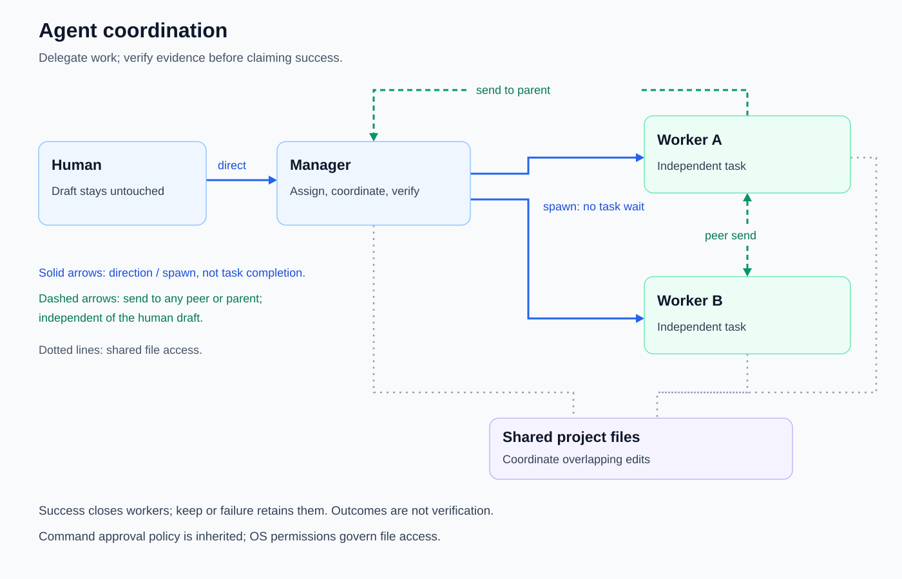

# Native agent ecosystem

Delegate independent tasks recursively, with one shared directory and capacity budget.

Introduced **2026-09-29** · commit `277c243` (tmux sub-agent commands).

## Current behavior

- The root session is a fixed manager. Descendants start as workers and can change their own role with `set_role` (`role: manager` or `worker`). Only managers can `spawn`; promotion enables recursive delegation without creating another capacity allowance.
- `spawn` takes `name` and `task`, returns without waiting for task completion, and opens a named tmux pane. Use `keep: true` for follow-up work. Descendants show the full assignment in a distinct [startup task banner](terminal-feedback.md#assigned-task-startup-banner) before model/tool work; it remains in scrollback, not pinned.
- `list` discovers the ecosystem directory; `stats` reports shared live-session, manager/worker and capacity counts. Use returned stable `kh:<id>` addresses for coordination. Short `kh:<name>` aliases resolve within the current ecosystem, not across unrelated roots.
- Any participant can `send` a single-line message to another agent in the same ecosystem, regardless of ownership branch or role.
- `inspect` returns safe shared details, a first-line task summary capped at 280 runes, and bounded conclusions. `peek` is an alias for that safe view, not a capture of private pane output or full conversation history.
- `stop` takes an `address` and optional `scope: agent` (default) or `subtree`. See [lifecycle and capacity](worker-lifecycle.md) for stop accounting and safeguards.
- Workers share project files, not isolated worktrees. There is no dependency scheduler; assign independent files or coordinate overlapping edits explicitly.
- Peer messages are attributed and displayed distinctly from human input; they are not human approval responses and [do not submit or modify the user's draft](input.md#peer-messages-and-drafts). Workers retrieve shared memory without learning delegated prompts as user instructions; see [learning-origin filtering](learning-origin.md).
- All ecosystem pane/tab names show a [live descendant count and role](terminal-feedback.md#live-descendant-counts), including zero for leaf workers; see [worker lifecycle](worker-lifecycle.md) for successful/failed pane behavior, `keep`, and inherited policy.

## Coordination diagram

[Coordination SVG](../diagrams/agent-coordination.svg): solid arrows show direction or spawn, not completion; dashed arrows show messages; dotted lines show shared registry access. Ownership is a tree, but messaging, discovery and inspection are ecosystem-wide. Share compact conclusions and evidence deliberately; private conversation histories are not the coordination protocol. Shared files and memory are not security isolation.

## Human as CEO, main agent as manager

Keep direction and important choices with the human. Every current manager, including promoted descendants, plans, allocates execution to workers, coordinates their work, assesses evidence, resolves conflicts, and presents verified outcomes. Managers assign implementation and integration edits, routine tests, builds, installation and restart execution to workers, rather than performing that execution themselves. Finished workers do not transfer execution back to the manager: retain or reassign a worker or spawn another scoped worker. At full capacity, retain orchestration and wait, inspect or stop work before retrying; do not fall back to executing the task.

Managers delegate substantial investigation and source/document exploration. Once delegated, do not independently repeat broad exploration; use concise worker conclusions and targeted follow-ups first. Managers may answer ordinary informational questions directly, do initial scoping, and make narrow reads for specific missing evidence, conflicts or verification. Not every reply requires a worker. Workers execute their assigned scope, including integration and checks, and return conclusions, exact references, checks and uncertainty, not raw history or bulk source; they need not promote or delegate. On promotion, hand existing coding or execution tasks to workers before continuing. Do not switch roles to bypass delegation or become a worker while managing live descendants.

These role-conditional duties are supplied in universal runtime instructions to new and resumed roots and descendants, even with a custom system prompt. Successful native-tool promotion also returns a short manager reminder; CLI `set_role` keeps its JSON snapshot output. This is operating policy, not a hard tool prohibition: it does not add a deterministic scheduler or automatic runtime delegation. A useful request is:

> Split this change into independent tasks, delegate implementation and review, integrate the results, and report what you verified. Ask me only for decisions you cannot make safely.

### Duplicate manager exploration

The reported problem is a manager delegating investigation but then independently rereading broad source/document sets, duplicating worker effort and expanding the manager's context. The instruction-level fix is to consume compact worker evidence first and reserve direct reads for initial scoping or a specific evidence gap, conflict or verification need. Root/resume instructions, the native promotion reminder, the discoverable tool contract and repository guidance carry this policy. Regression tests check instruction delivery and the bounded-read exceptions, not deterministic model compliance; no hard read blocking or automatic scheduler is added.

## Integrate and verify

1. Inspect the project and divide work by ownership or independent concern.
2. Give each worker a concrete outcome, scope, and verification requirement.
3. Collect concise conclusions, exact references, checks and uncertainty; use targeted follow-ups before direct reads and resolve overlapping changes before integration.
4. Assign relevant checks to workers, assess their evidence, inspect the combined diff, and state any remaining uncertainty.

The harness provides tools and visibility; the agent remains responsible for choosing and checking this workflow. Follow [development conventions](development.md) and the shared [command approval](write-approvals.md) and [shell execution guidance](shell.md). [External coding CLIs](external-clis.md) are shell subprocesses, not native workers.

## Evolution

| Date | Change | Commit |
|---|---|---|
| 2026-09-29 | Added shared-folder tmux sub-agent commands. | `277c243` |
| 2026-09-29 | Added named agent routing. | `14dd3e6` |
| 2026-10-04 | Added the native `agents` tool and coordinator implementation. | `c8de1bf` |
| 2026-10-16 | Excluded worker/peer prompts from user-facing memory learning. | `46c225b` |
| 2026-10-25 | Added isolated peer transport and live receiver checks instead of simulated typing into the human draft. | `dee1c86` |
| 2026-10-31 | Added recursive roles, a shared registry/capacity budget, ecosystem discovery, safe inspection and stop controls. | Current change |
| 2026-11-01 | Made manager execution delegation explicit for roots and promoted descendants, with universal role-conditional instructions and a native promotion reminder. | Current change |
| 2026-11-03 | Extended manager delegation to substantial investigation and source/document exploration; prefer compact worker evidence over duplicate broad reads while retaining initial scoping and targeted verification. | Current change |

## Inspect

[Agents tool](../internal/tools/agents.go) · [Coordinator](../cmd/kh/agents.go) · [Runtime wiring](../cmd/kh/ecosystem.go) · [Registry](../internal/ecosystem/registry.go) · [Tool tests](../internal/tools/test/agents_test.go) · [Instruction delivery tests](../cmd/kh/test/manager_policy_test.go)

[Feature index](README.md)
