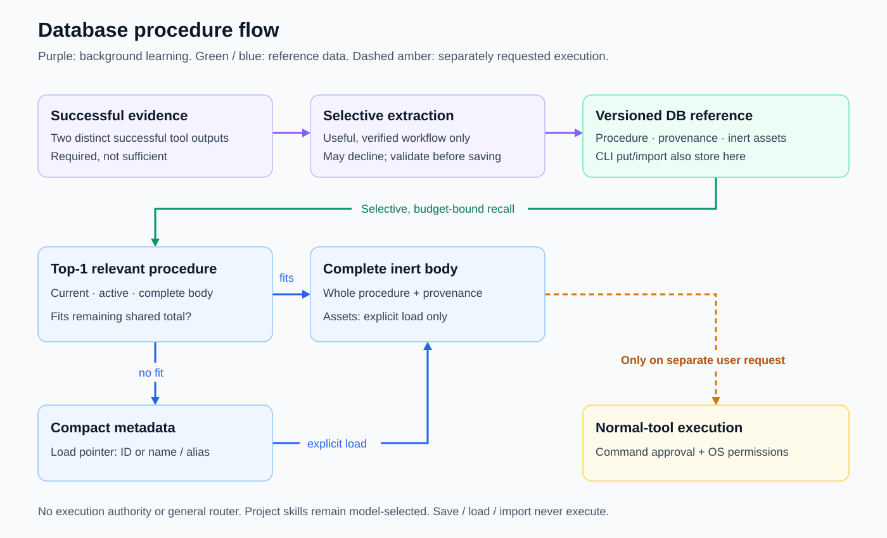

# On-demand references and assets

Keep routine recall compact while making complete workflows available when needed.

Introduced **2026-10-23** · commit `f802b27`.

## Current behavior

Procedural references live in the [memory database](knowledge-store.md) with full workflows, aliases, and inert script assets. Names, aliases, and topics retrieve compact hints; the memory tool's `load` action fetches a full procedure by version ID or name/alias, or its asset content on demand. [Procedure learning](procedure-learning.md) can populate references automatically; [portability controls](procedure-portability.md) manage them explicitly.

Reference content is inert data, not authority: saving, retrieving, loading, and importing never execute scripts. Requested execution must use ordinary tools subject to command approval and OS permissions. Database procedures are separate from [filesystem-backed project skills](project-configuration.md); these documentation pages are not a second knowledge store. Recall attempts the top eligible current, unexpired database procedure only: its whole body and compact provenance (memory ID, scope, and statement date) load automatically when they fit the remaining budget. Full owner/source/discussion/import provenance remains available through get/load. Assets never autoload; they remain available through explicit `load`. If the body is oversized, a compact hint and diagnostic leave explicit loading available. Named matches precede contextual topic matches. Selection is relevance-driven and bounded, not a dump of every procedure body. This does not add a general task router: filesystem project skills remain model-selected through project capability discovery.

A successfully injected metadata fallback counts as seen. Increasing the budget later in the same chat therefore does not automatically retry that procedure body. The model can still use the existing `load` action without requiring a fresh manual user request; after compaction drops the old context, normal recall may load it again. No separate body-delivery receipt is stored.

## Procedure flow

Solid arrows show conditional learning and retrieval, not automatic execution. Two distinct successful tool outputs are required but insufficient for learning; extraction can decline. Relevant complete procedures enter recall only when they fit; otherwise compact hints support on-demand loading. Loading exposes reference data, not instructions with execution authority. Saving, loading, and importing never execute assets.

## Evolution

| Date | Change | Commit |
|---|---|---|
| 2026-10-23 | Added database-native reference payloads, aliases/assets, compact recall hints, and memory-tool loading. | `f802b27` |
| 2026-10-23 | Added applicability improvements and retrieval explanations for selected context. | `24e64b7` |
| 2026-10-23 | Added autonomous learning that can create and improve references for later loading. | `23e7a86` |

## Inspect

- Source: [reference store](../internal/memory/references.go), [recall hints](../internal/memory/recall.go), [memory tool](../internal/tools/memory.go).
- Tests: [reference storage](../internal/memory/test/references_test.go), [reference recall](../internal/memory/test/reference_recall_test.go), [tool loading](../internal/tools/test/reference_test.go).

[Feature index](README.md)

## 2026-11-11 — Automatically admit the top relevant whole procedure body

- Status: implemented
- Rationale: Improve relevant workflow reuse within the existing memory engine: named matches precede contextual matches, and only the top eligible current unexpired database procedure gets automatic whole-body admission when it fits. Include compact memory-ID/scope/date provenance, keep full provenance and assets on explicit get/load, and retain a compact hint plus diagnostics when oversized. Reference data never executes itself; filesystem project skills remain model-selected and this is not a general task router.
- Affected: internal/memory/recall.go; procedure-loading.md; procedure-flow.svg; reference recall tests
- Verification / outstanding: Whole-body fit/fallback regressions, final normal suite and memory race checks passed; independent review found no remaining demonstrated defects. Source checks confirm no assets autoload or execution path was added. Diagram owner inspected rendered full/detail pixels and checked XML, incoming links and installed SVG equality. See [combined verification and race scope](keyword-recall.md); the seen-metadata retry limitation remains documented above.
