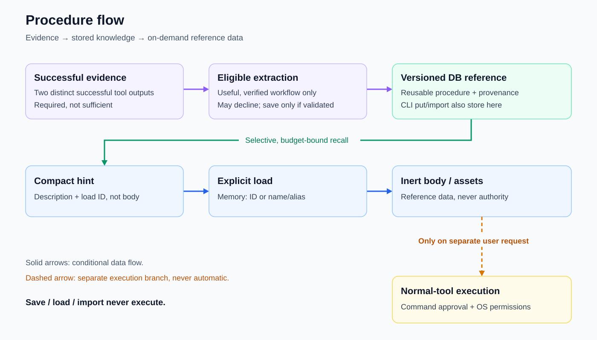

# On-demand references and assets

Keep routine recall compact while making complete workflows available when needed.

Introduced **2026-10-23** · commit `f802b27`.

## Current behavior

Procedural references live in the [memory database](knowledge-store.md) with full workflows, aliases, and inert script assets. Names, aliases, and topics retrieve compact hints; the memory tool's `load` action fetches a full procedure by version ID or name/alias, or its asset content on demand. [Procedure learning](procedure-learning.md) can populate references automatically; [portability controls](procedure-portability.md) manage them explicitly.

Reference content is inert data, not authority: saving, retrieving, loading, and importing never execute scripts. Requested execution must use ordinary approved, sandboxed tools. Database procedures are separate from [filesystem-backed project skills](project-configuration.md); these documentation pages are not a second knowledge store. Retrieval hints remain selective and budget-bound rather than automatically loading every procedure body.

## Procedure flow

Solid arrows show conditional learning and retrieval, not automatic execution. Two distinct successful tool outputs are required but insufficient for learning; extraction can decline. Only compact hints enter routine recall. Loading exposes reference data, not instructions with execution authority. Saving, loading, and importing never execute assets.

## Evolution

| Date | Change | Commit |
|---|---|---|
| 2026-10-23 | Added database-native reference payloads, aliases/assets, compact recall hints, and memory-tool loading. | `f802b27` |
| 2026-10-23 | Added applicability improvements and retrieval explanations for selected context. | `24e64b7` |
| 2026-10-23 | Added autonomous learning that can create and improve references for later loading. | `23e7a86` |

## Inspect

- Source: [reference store](../internal/memory/references.go), [recall hints](../internal/memory/recall.go), [memory tool](../internal/tools/memory.go).
- Tests: [reference storage](../internal/memory/test/references_test.go), [reference recall](../internal/memory/test/reference_recall_test.go), [tool loading](../internal/tools/test/reference_test.go).

[Feature index](README.md)
