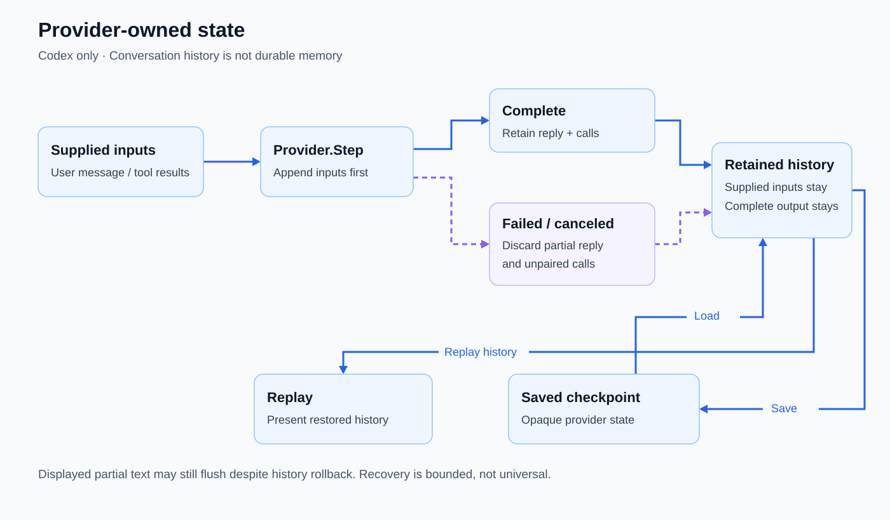

# Provider separation and resumable state

Keep model protocols and conversation history out of the orchestration loop.

Introduced **2026-09-28** · commit `84d64c8` (provider-owned history contract; persistence followed that day).

## Current behavior

The backend-neutral provider contract owns stepping, saved state, loading, and replay; only Codex is implemented. Failed or canceled partial steps discard incomplete replies and calls while preserving supplied user inputs and tool results. Saved conversations resume provider history, separately from durable memory. This separation is not a claim of multiple working model backends or lossless context compaction.

## State lifecycle

`Provider.Step` receives a user message and/or tool results. Codex appends those supplied inputs before taking the rollback boundary. A completed stream retains its reply items and calls; failure or cancellation preserves the supplied inputs but discards that step's partial reply and unpaired calls. Displayed partial text may still flush to the terminal even though it is rolled back from history; display is not evidence of a completed, resumable reply.

`Save` serializes opaque provider state, and `Load` restores it from a saved checkpoint. `Replay` presents the restored conversation history; it does not rerun tools or regenerate replies. These checkpoints are conversation state, not the durable memory store. Only Codex implements the contract today. [Connection recovery](connection-recovery.md#current-behavior) has bounded, selective retries; it does not make every failed stream retryable.

Source verification: the [provider contract](../internal/provider/provider.go) defines input preservation; [Codex Step, Save, Load, and Replay](../internal/provider/codex/client.go) implement the history boundary and persistence; [stream handling](../internal/provider/codex/stream.go) distinguishes completion from incomplete output and flushes presentation. [Retry handling](../internal/provider/codex/retry.go) resets failed attempts to the supplied-input boundary. [Stream](../internal/provider/codex/test/stream_test.go), [flush](../internal/provider/codex/test/flush_test.go), and [retry tests](../internal/provider/codex/test/retry_test.go) exercise those distinctions.

## Evolution

| Date | Change | Commit |
|---|---|---|
| 2026-09-28 | Initial provider contract kept wire history inside the backend. | `84d64c8` |
| 2026-09-28 | Added save/load and resumable chat. | `3354dc0` |
| 2026-09-28 | Added replay of earlier conversation on resume. | `3e21914` |
| 2026-10-01 | Decoupled orchestration and hardened incomplete-step handling. | `60e2bd1` |
| 2026-10-04 | Consolidated the Codex adapter and backend selection. | `17cb8d1` |

## Inspect

- [Provider contract](../internal/provider/provider.go) and [Codex stream handling](../internal/provider/codex/stream.go)
- [Stream tests](../internal/provider/codex/test/stream_test.go)
- [Provider-owned history](architecture.md#provider-owned-history) and [saved sessions](saved-sessions.md)

[Feature index](README.md)
