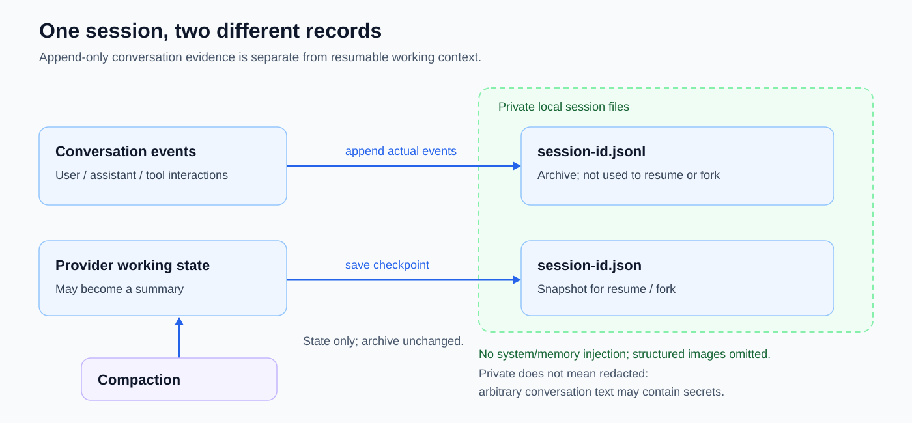
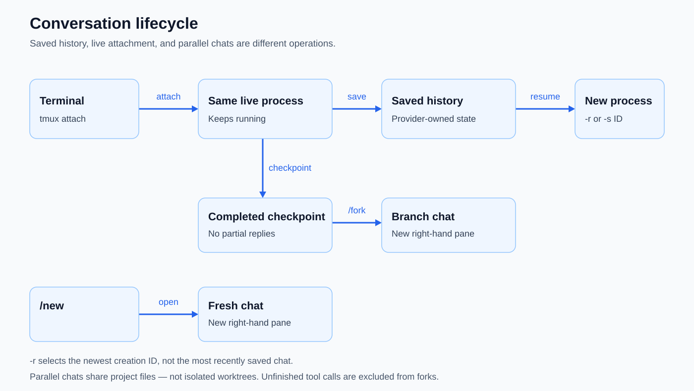

# Saved history and replay

Resume completed work from a saved conversation, separately from durable memory.

Introduced **2026-09-28** · commit `3354dc0`.

## Current behavior

- `kh --sessions` (or `kh sessions`) lists all this folder’s saved chats, including subagents, newest-save first. Previews show `[main]`, `[subagent: name]`, or `[unknown]` alongside the session ID, with text shortened to fit the terminal width.
- New chats persist their role, name and parent when available. Only `KH_PARENT` identifies a new subagent; an address alone does not. Resume preserves the saved identity, and older chats without metadata stay unknown. `/new` and `/fork` open main chats even when invoked from a worker.
- `kh -r` resumes the newest creation ID; `kh -s ID` selects one. Latest does not mean most recently saved.
- Provider-owned history is saved after turns as `<session-id>.json` under `~/.kh/sessions`, scoped to the working folder with symlinks resolved. A separate [JSONL conversation archive](#conversation-archive) records new interactions without replacing that resumable snapshot.
- Resume replays history in a new chat process; it does not [reattach a running tmux chat](tmux-chats.md). Failed partial replies are not completed checkpoints.
- The [memory database](knowledge-store.md) is separate from saved conversation history. See [provider-owned state](provider-state.md) for history ownership and [compaction](compaction.md) for summarizing working context.

## Conversation archive

[Archive overview SVG](../diagrams/session-archive.svg): JSON snapshots are working context for resume and fork; JSONL is a separate record of actual interactions. Neither is the [durable memory database](knowledge-store.md).

### Storage and lifecycle

The archive is `<session-id>.jsonl` beside the snapshot in `~/.kh/sessions/v2/<folder-hash>/`. The hash identifies the canonical working folder. Archive files are private local files (`0600`; newly created session directories `0700`), not encrypted storage.

- New and resumed sessions append to their own archive. A session-start event distinguishes startup modes. Resume uses the JSON snapshot and does not archive replayed history again.
- Existing snapshots are not retroactively backfilled. A fork copies the completed JSON checkpoint but starts a new archive; it does not copy its parent's log. An older session resumed through legacy snapshot fallback writes its new archive in the v2 folder.
- [Compaction](compaction.md) replaces only working provider context and its JSON snapshot. It never replaces or deletes the archive, and its synthetic summary request and response are not archived.
- The archive is not a resume/recovery input, and session listing still discovers JSON snapshots. There is no archive viewer, import, automatic rotation, or retention limit; the log can grow independently of compacted context.

### Contents and privacy

Version 1 records carry `id`, `session_id` and UTC `timestamp`, with `message_id`, `attempt_id` or `call_id` where applicable. Receipt time is not a server-side generation timestamp. Event `type` values are `session_start`, `user_message`, `attempt_start`, `assistant_delta`, `assistant_end`, `tool_call`, `tool_result`, `hosted_action` and `attempt_end`.

Assistant text includes commentary and final phases, not just the final successful checkpoint. Join deltas by message ID; `assistant_end` marks the message `completed` or `interrupted`, while `attempt_end` distinguishes `completed`, `failed` and `interrupted` attempts. A completed message in a failed attempt is not a completed resumable step. An abrupt process death may leave an attempt without an end event. Tool calls record local function names and arguments; results record text and error status with the matching call ID. Public provider-hosted web-search actions appear as `hosted_action` records named `web_search`, with the displayed action text; they are not local tool-call/result pairs or a capture of hosted search results.

User-message `origin` distinguishes `user`, `peer` and `delegated` input. Peer deliveries and delegated task prompts are recorded as such, not mistaken for direct user input. These records precede project-command expansion and injected runtime context. A `session_start` origin distinguishes `new`, `resume` and `fork`; fork startup can include `parent_session_id` without copying the parent archive.

The archive excludes internal system prompts, automatically injected memory, authentication plumbing, reasoning and structured image attachments. Tool-result text retains returned decoration, including ecosystem snapshots; it is not generically stripped as runtime context. Tool-argument fields named `content_base64`, `image_base64` and `image_url` are scrubbed recursively. Complete image data URLs within an individual text event or argument are replaced with an omission marker. This is not universal redaction: URLs split across streamed events, other encoded data, user/assistant text, tool arguments and output can still contain image data, credentials or other sensitive information. Treat the entire archive as private before copying or sharing it.

### Write and recovery limits

An archive-open failure aborts startup. Append failures are reported and latched: subsequent writes do not silently resume, and the active request stops before executing returned calls or requesting another response. Already completed tool results are still paired in provider history through cancellation cleanup, and the turn still attempts its JSON snapshot save. Archive-close errors are printed. A failed archive is not automatically rebuilt from the snapshot; resolve the reported file problem before restarting.

Archive records are limited to 32 MiB each. Writes append immediately; semantic boundaries are synced to disk rather than syncing every streamed text delta. A crash can still lose unsynced output. An exclusive lock rejects a second simultaneous writer for the same session archive.

On opening an existing log, a valid final JSON record without a newline is preserved and terminated. Only an invalid, unterminated final record is truncated back to the preceding complete line. Malformed newline-terminated records or oversized records are errors, not silently skipped repairs. The streaming reader tolerates an invalid partial final line but rejects malformed complete records. Opening checks JSON syntax, not event-schema validity or cryptographic integrity. These rules do not reconstruct missing events or recover resumable provider state from the log.

## Conversation lifecycle

Save writes provider history; resume starts a new process, while tmux attachment reconnects to the same live process. Forks use completed checkpoints, not partial replies or unfinished tool calls; parallel chats share project files rather than isolated worktrees. `/new` starts fresh. `-r` chooses the newest creation ID, not the latest save time.

## Evolution

| Date | Change | Commit |
|---|---|---|
| 2026-09-28 | Added chat mode, turn saves, and resume flags. | `3354dc0` |
| 2026-09-28 | Added earlier-chat replay and session listing. | `3e21914` |
| 2026-10-01 | Made saved state provider-owned; added atomic saves and ID validation. | `60e2bd1` |
| 2026-10-04 | Improved session previews. | `b0e6dc2` |
| 2026-10-30 | List all saved chats with persisted main/subagent identity and unknown legacy labels. | Working tree (uncommitted) |
| 2026-11-02 | Add a private append-only JSONL conversation archive alongside resumable JSON snapshots; keep replay, forks and compaction separate. | Working tree (uncommitted) |

## Inspect

[Session store](../internal/session/session.go) · [Archive storage and reader](../internal/session/archive.go) · [Archive tests](../internal/session/test/archive_test.go) · [Chat capture wiring](../cmd/kh/chat.go) · [CLI tests](../cmd/kh/test/sessions_test.go) · [Restart onto a new build](startup-rebuild.md#restart-onto-a-new-build)

[Feature index](README.md)
