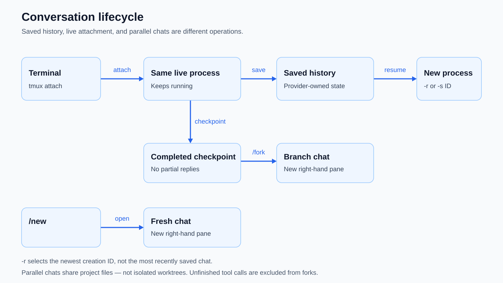

# Saved history and replay

Resume completed work from a saved conversation, separately from durable memory.

Introduced **2026-09-28** · commit `3354dc0`.

## Current behavior

- `kh --sessions` (or `kh sessions`) lists all this folder’s saved chats, including subagents, newest-save first. Previews show `[main]`, `[subagent: name]`, or `[unknown]` alongside the session ID, with text shortened to fit the terminal width.
- New chats persist their role, name and parent when available. Only `KH_PARENT` identifies a new subagent; an address alone does not. Resume preserves the saved identity, and older chats without metadata stay unknown. `/new` and `/fork` open main chats even when invoked from a worker.
- `kh -r` resumes the newest creation ID; `kh -s ID` selects one. Latest does not mean most recently saved.
- Provider-owned history is saved after turns under `~/.kh/sessions`, scoped to the working folder with symlinks resolved.
- Resume replays history in a new chat process; it does not [reattach a running tmux chat](tmux-chats.md). Failed partial replies are not completed checkpoints.
- The [memory database](knowledge-store.md) is separate from saved conversation history. See [provider-owned state](provider-state.md) for history ownership and [compaction](compaction.md) for summarizing working context.

## Conversation lifecycle

Save writes provider history; resume starts a new process, while tmux attachment reconnects to the same live process. Forks use completed checkpoints, not partial replies or unfinished tool calls; parallel chats share project files rather than isolated worktrees. `/new` starts fresh. `-r` chooses the newest creation ID, not the latest save time.

## Evolution

| Date | Change | Commit |
|---|---|---|
| 2026-09-28 | Added chat mode, turn saves, and resume flags. | `3354dc0` |
| 2026-09-28 | Added earlier-chat replay and session listing. | `3e21914` |
| 2026-10-01 | Made saved state provider-owned; added atomic saves and ID validation. | `60e2bd1` |
| 2026-10-04 | Improved session previews. | `b0e6dc2` |
| 2026-10-30 | List all saved chats with persisted main/subagent identity and unknown legacy labels. | Working tree (uncommitted) |

## Inspect

[Session store](../internal/session/session.go) · [CLI tests](../cmd/kh/test/sessions_test.go) · [Restart onto a new build](startup-rebuild.md#restart-onto-a-new-build)

[Feature index](README.md)
