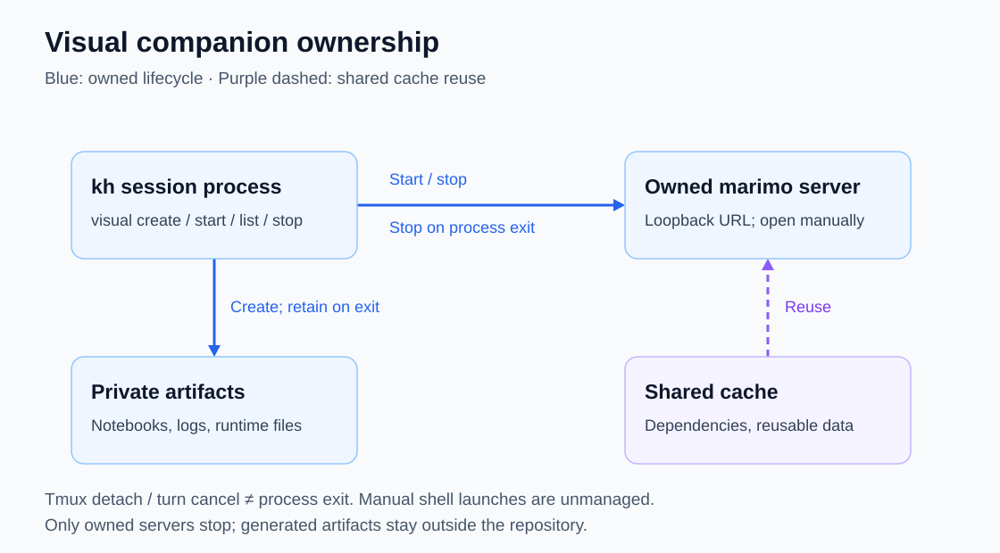

# Visual companion

Explore explanations interactively in a browser alongside chat. The native `visual` tool manages session-owned marimo notebooks and servers; the [standalone example](../examples/visual-companion/README.md) can also run independently.

Introduced as a standalone example on **2026-10-29** in `ed67393`; native lifecycle management followed the same day.

## Availability and use

Requires `uv` on `PATH` and network access for uncached dependencies. No browser tab opens automatically: open the returned local URL yourself.

Native launches use `uv run --with-requirements notebook.py` to provision packages from PEP 723 metadata, then `marimo run --watch --no-sandbox` to render the app immediately, reload notebook edits, and keep the server attached to its guardian. This marimo environment-launcher option is distinct from the OS Bash sandbox: existing sandbox configuration and approvals still apply. Native launch does not explicitly select Python from `requires-python`; the example declares Python 3.11+.

Ask kh to create a visual explanation. The tool workflow is:

1. `visual` with `action="create"` and `name="experiment"` creates a notebook skeleton and returns its path.
2. Edit that notebook using the normal [editing tool](editing.md).
3. `action="start"` with the same name starts the rendered app with file watching on a free loopback port and returns an authenticated URL and log path; an explicit `port` (1024–65535) is optional.
4. `action="list"` inspects managed servers; `action="stop"` stops a named server without deleting the notebook.

The tool accepts notebook names, not arbitrary server commands or environment overrides. Existing [write/execution approvals](write-approvals.md) and the [shell sandbox](shell-sandbox.md) still apply. Standalone shell launches are **unmanaged**: see the [example README](../examples/visual-companion/README.md) for launch and regression-check commands.

## Ownership and storage

[Ownership SVG](../diagrams/visual-companion.svg): process lifetime, not tmux attachment or turn lifetime, controls cleanup.

Managed notebooks use a private `~/.kh/artifacts/visual-<random-process-instance>/` workspace for notebooks, logs, temporary files, configuration, and state. Dependencies and reusable caches live separately under `~/.kh/cache/visual/` (including uv, Python, tools, data, bytecode, and matplotlib caches). Generated files stay outside the repository; cache reuse does not transfer ownership of a server.

A server belongs to the kh process that launched it, not to a tmux attachment or a model turn. Detaching tmux, cancelling a later turn, or finishing an answer leaves an already-running server alive. Cancelling startup aborts that new launch. Normal session-process shutdown stops its owned servers; explicit `stop` does the same for one server. Unrelated marimo servers—including standalone launches—are not killed. Notebooks and logs are retained after shutdown.

A pipe-watching guardian also cleans up after owner `os.Exit`, SIGTERM, or SIGKILL; process tests verify server and descendant termination while a sibling session survives. This protection requires the guardian to remain alive and descendants to stay in its process group: independently killing the guardian or escaping that group is not covered.

## Example and limits

The [learning-rate notebook](../examples/visual-companion/companion.py) recomputes 20 gradient-descent updates for **f(x) = x²**, starting at **x = 4**. It plots the parameter trajectory and log-scale loss with a reactive explanation.

| Learning rate η | Expected result |
|---|---|
| 0.20 | Approach zero without crossing it |
| 0.50 | Reach zero in one update |
| 0.90 | Oscillate with shrinking magnitude |
| 1.00 | Alternate between +4 and −4 without improving loss |
| 1.10 | Oscillate with growing magnitude |

Lifecycle management is not chat synchronization, browser navigation, or notebook-to-agent tool access. The example's thresholds apply only to this quadratic; its loss plot floors zero at 10⁻³⁰ for display, while the reported loss uses the computed value.

## Evidence

- [Tool interface](../internal/tools/visual.go) and [CLI wiring](../cmd/kh/main.go): native actions, shared approval policy, and process-owned manager.
- [Runtime manager](../internal/visual/manager.go): notebook creation, fixed marimo launch, readiness, storage, and owned-server lifecycle; [guardian](../internal/visual/guardian.go): private ownership pipe and process-group cleanup.
- [Lifecycle regression tests](../internal/visual/test/manager_test.go): fixed uv dependency and `--no-sandbox` launch arguments, owned-server isolation, retained artifacts, cancellation, failed starts, invalid paths, and guardian cleanup after owner `os.Exit`, SIGTERM, and SIGKILL using a fake server and descendant process.
- [Notebook source](../examples/visual-companion/companion.py): dependency metadata, slider, update rule, plots, and explanation.
- [Notebook regression checks](../examples/visual-companion/test/check_companion.py): public `app.run()` API, default value, five regimes, trajectories, explanations, plotted series, and log-scale loss. Commands live in the [example README](../examples/visual-companion/README.md#regression-checks).
- Native browser/lifecycle smoke check under the OS sandbox: the rendered, watched companion updated its plot and final x from approximately 0.0001462 to 153.4 when η changed from 0.20 to 1.10, without JavaScript errors. Explicit stop closed the listener and retained the notebook; restarting and then exiting the owning worker also closed the listener and retained the notebook. This is a manual smoke check, not automated regression coverage.
- Initial standalone browser smoke check: changing η from 0.20 to 1.10 updated both plots and the explanation without page errors; screenshots were visually inspected. This historical check is not native-runtime regression coverage.

## History

| Date | Change | Commit |
|---|---|---|
| 2026-10-29 | Standalone marimo demonstration and initial documentation. | `ed67393` |
| 2026-10-29 | Native session-owned notebook/server lifecycle; external artifacts and shared dependency cache. | This release |

[Feature index](README.md)
