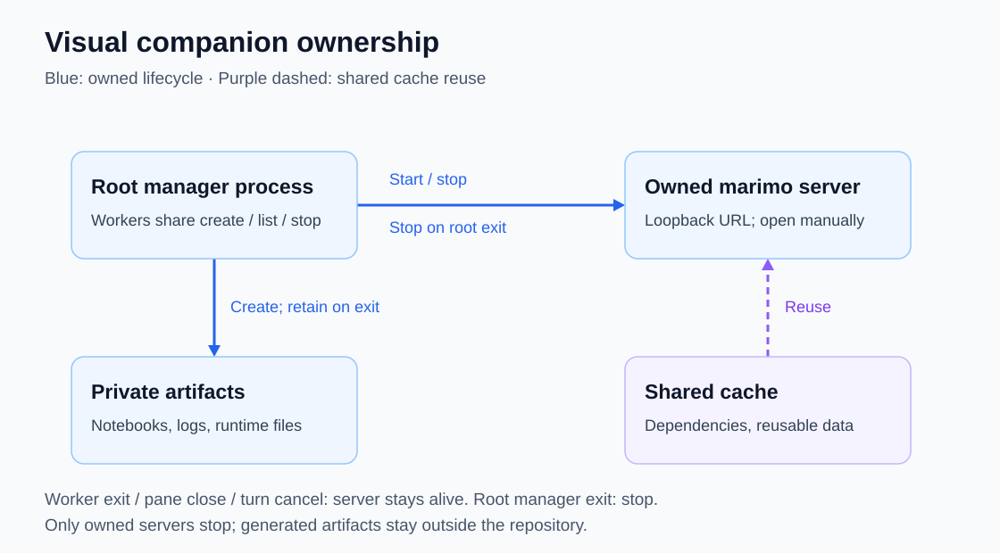

# Visual companion

Explore explanations interactively in a browser alongside chat. The native `visual` tool manages session-owned marimo notebooks and servers; the [standalone example](../examples/visual-companion/README.md) can also run independently.

Introduced as a standalone example on **2026-10-29** in `ed67393`; native lifecycle management followed the same day.

## Availability and use

Requires `uv` on `PATH` and network access for uncached dependencies. No browser tab opens automatically: open the returned local URL yourself.

Native launches use `uv run --with-requirements notebook.py` to provision packages from PEP 723 metadata, then `marimo run --watch --no-sandbox` to render the app immediately, reload notebook edits, and keep the server attached to its guardian. This is a marimo environment-launcher option, not a kh filesystem restriction. Native starts require normal command approval and operate subject to OS permissions. Native launch does not explicitly select Python from `requires-python`; the example declares Python 3.11+.

Ask kh to create a visual explanation. The tool workflow is:

1. `visual` with `action="create"` and `name="experiment"` creates a notebook skeleton and returns its path.
2. Edit that notebook using the normal [editing tool](editing.md).
3. `action="start"` with the same name starts the rendered app with file watching on a free loopback port and returns an authenticated URL and log path; an explicit `port` (1024–65535) is optional.
4. `action="list"` inspects managed servers; `action="stop"` stops a named server without deleting the notebook.

The tool accepts notebook names, not arbitrary server commands or environment overrides. Normal [command approvals](write-approvals.md) and OS permissions apply; kh imposes no filesystem confinement. Standalone shell launches are **unmanaged**: see the [example README](../examples/visual-companion/README.md) for launch and regression-check commands.

## Ownership and storage

[Ownership SVG](../diagrams/visual-companion.svg): the root manager process owns cleanup, independently of worker panes and model turns.

Managed notebooks use a private `~/.kh/artifacts/visual-<root-process-identity-hash>/` workspace shared by the root manager and its workers for notebooks, logs, temporary files, configuration, and state. Notebook names are unique within that root session; workers can list or stop a server another worker launched. Dependencies and reusable caches live separately under `~/.kh/cache/visual/` (including uv, Python, tools, data, bytecode, and matplotlib caches). Generated files stay outside the repository; cache reuse does not transfer ownership of a server.

A server belongs to the root kh manager process, **not the worker that launched it**. Worker completion, automatic pane closure, tmux detach, cancelling a later turn, and finishing an answer leave an already-running server alive. Cancelling startup or losing its launching worker before readiness aborts that new launch. Closing the root manager session stops all its managed servers; explicit `stop` from the root or any worker stops one. Unrelated root sessions and standalone launches are not killed. Notebooks and logs are retained after shutdown.

The guardian starts in a detached OS session, outside the worker terminal's lifetime. A private launch pipe controls startup until readiness and an atomic private manifest transfer ownership to the root. The guardian then watches the root's PID **and kernel start identity**, plus explicit stop/closed markers, and cleans up after graceful shutdown, `os.Exit`, SIGTERM, SIGHUP, or SIGKILL. Shared-state locking serializes launch/stop; cancellation bounds lock waits, and root shutdown aborts pending launches rather than waiting for dependency installation. Root identity probes that fail inconclusively are retried, not treated as proof of exit. This protection requires the guardian to remain alive and descendants to stay in its process group: independently killing the guardian or escaping that group is not covered. A resumed root process uses a new identity/workspace, not the old process's servers.

## Example and limits

The [learning-rate notebook](../examples/visual-companion/companion.py) recomputes 20 gradient-descent updates for **f(x) = x²**, starting at **x = 4**. It plots the parameter trajectory and log-scale loss with a reactive explanation.

| Learning rate η | Expected result |
|---|---|
| 0.20 | Approach zero without crossing it |
| 0.50 | Reach zero in one update |
| 0.90 | Oscillate with shrinking magnitude |
| 1.00 | Alternate between +4 and −4 without improving loss |
| 1.10 | Oscillate with growing magnitude |

Lifecycle management is not chat synchronization, browser navigation, or notebook-to-agent tool access. The example's thresholds apply only to this quadratic; its loss plot floors zero at 10⁻³⁰ for display, while the reported loss uses the computed value.

## Evidence

- [Tool interface](../internal/tools/visual.go), [CLI wiring](../cmd/kh/main.go), and [task-worker wiring](../cmd/kh/worker.go): native actions, shared approval policy, and root-process-owned manager. [Worker setup regressions](../cmd/kh/test/worker_visual_test.go) exercise structured and reusable workers through their actual tool registry and verify shared root artifacts without closing root ownership.
- [Runtime manager](../internal/visual/manager.go): notebook creation, fixed marimo launch, readiness, storage, and owned-server lifecycle; [shared state](../internal/visual/shared.go): root-scoped manifests and explicit stop; [guardian](../internal/visual/guardian.go): launch handoff, root monitoring, and process-group cleanup.
- [Lifecycle regression tests](../internal/visual/test/manager_test.go): fixed uv dependency and `--no-sandbox` launch arguments, owned-server isolation, retained artifacts, cancellation, failed starts, invalid paths, and guardian cleanup after owner `os.Exit`, SIGTERM, and SIGKILL using a fake server and descendant process.
- [Root/worker regressions](../internal/visual/test/shared_test.go): worker close/exit/SIGTERM/SIGKILL/pane-style SIGHUP survival, root graceful/abrupt cleanup, cross-client list/stop, independent-session isolation, stale start-identity rejection, cancellable lock waits, and worker/root death during startup using a fake server and descendant process.
- [Notebook source](../examples/visual-companion/companion.py): dependency metadata, slider, update rule, plots, and explanation.
- [Notebook regression checks](../examples/visual-companion/test/check_companion.py): public `app.run()` API, default value, five regimes, trajectories, explanations, plotted series, and log-scale loss. Commands live in the [example README](../examples/visual-companion/README.md#regression-checks).
- Historical native browser/lifecycle smoke check (before filesystem confinement was removed): the rendered, watched companion updated its plot and final x from approximately 0.0001462 to 153.4 when η changed from 0.20 to 1.10, without JavaScript errors. Explicit stop closed the listener and retained the notebook; restarting and then exiting the owning worker also closed the listener and retained the notebook. This is a manual smoke check of the superseded worker-owned lifecycle, not current ownership behavior or automated regression coverage.
- Initial standalone browser smoke check: changing η from 0.20 to 1.10 updated both plots and the explanation without page errors; screenshots were visually inspected. This historical check is not native-runtime regression coverage.

## History

| Date | Change | Commit |
|---|---|---|
| 2026-10-29 | Standalone marimo demonstration and initial documentation. | `ed67393` |
| 2026-10-29 | Native launcher-process-owned lifecycle; external artifacts and shared cache. Launcher ownership superseded below. | This release |
| 2026-11-11 | Root manager owns worker-launched visuals; shared list/stop and detached guardian. | This release |

### 2026-11-11 — Root manager owns managed visual servers

- Status: implemented
- Rationale: Supersedes the 2026-10-29 launcher-process ownership rule: completing a worker closed its manager and ownership pipe, killing the user's visual. Bind ownership to the root manager's exact PID and kernel start identity instead; detach the guardian from worker terminals while preserving root shutdown cleanup, authenticated loopback launch and explicit stop from any root-session worker.
- Affected: internal/visual/manager.go, guardian.go and shared.go; internal/visual/test/manager_test.go and shared_test.go; cmd/kh/main.go and worker.go; cmd/kh/test/worker_visual_test.go; internal/tools/visual.go; diagrams/visual-companion.svg; this feature's ownership and evidence sections.
- Verification / outstanding: Targeted `go test ./internal/visual/test -count=1` passed, covering worker exit and pane-style SIGHUP survival, root graceful/abrupt cleanup, pending-startup cancellation, PID/start-token fencing, same-home independent roots, shared list/stop and retained artifacts. Formatting, diff whitespace, feature links and SVG XML checked; rendered SVG pixels inspected. Independent review found startup locking/shutdown edges, now fixed and regression-tested. Coverage simulates pane closure with process-group SIGHUP; it does not automate tmux or a real marimo browser session. Independently killed guardians or group-escaping descendants remain unsupported.

[Feature index](README.md)
